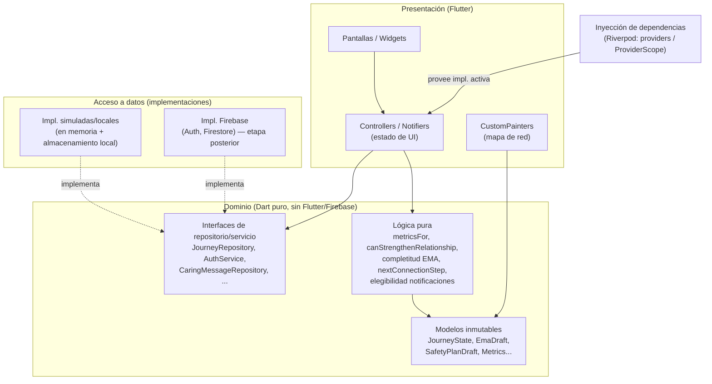

# Design Document

## Overview

Este documento describe el diseño para migrar el prototipo "Contigo" (React/Vite) a una app móvil Flutter que cubre los roles PCS y Cuidador, con Firebase/Google Cloud como backend previsto para una etapa posterior. La fuente autoritativa del comportamiento es `docs/analisis-prototipo.md` y los requisitos en `requirements.md`.

El objetivo de diseño es una arquitectura **simple y mantenible** que separe con claridad tres preocupaciones: **lógica de dominio**, **interfaz** y **acceso a datos**. La lógica de dominio del prototipo (que ya tiene pruebas) se porta con fidelidad a Dart y queda **independiente de Flutter y de Firebase**. El acceso a datos se esconde detrás de **abstracciones (repositorios/servicios)** para poder cambiar una implementación simulada por una de Firebase **sin tocar las pantallas**.

### Distinción crítica: capas de madurez vs. capas arquitectónicas

Las tres "capas" de los requisitos —**Capa_Local**, **Capa_Simulada** y **Capa_Firebase**— **no son capas de la arquitectura**. Son una clasificación de **madurez/etapa de implementación por funcionalidad**: indican si una funcionalidad opera localmente de verdad, está fingida a la espera de backend, o ya está respaldada por Firebase.

La arquitectura, en cambio, es la separación estándar **presentación / dominio / acceso a datos**. Que un repositorio concreto esté respaldado por una implementación local/simulada o por Firebase es **un detalle de implementación detrás de la misma interfaz**. Dicho de otro modo:

- "Capa_Local / Capa_Simulada / Capa_Firebase" = **metadato de estado** de cada feature (Requirement 3).
- "presentación / dominio / datos" = **estructura del código**.

Un `CaringMessageRepository` (interfaz del dominio) puede tener hoy una implementación simulada (Capa_Simulada) y mañana una de Firestore (Capa_Firebase); la pantalla no cambia. No se crean carpetas ni clases base llamadas "CapaLocal" / "CapaSimulada" / "CapaFirebase".

## Architecture

Arquitectura por capas con dependencias en una sola dirección (presentación → dominio ← datos). El dominio no depende de Flutter ni de Firebase; define las interfaces de repositorio. Las implementaciones de datos (simuladas/locales ahora, Firebase después) dependen del dominio e implementan sus interfaces. La presentación depende de las interfaces del dominio, nunca de implementaciones concretas.



**Regla de dependencia:** el dominio no importa `package:flutter` ni `package:firebase_*`. Esto hace que la lógica portada del prototipo sea testeable con `dart test` puro (como lo era con `node --test`).

**Estructura de carpetas propuesta** (simple, sin sobre-ingeniería):

```
lib/
  domain/        # modelos inmutables + lógica pura + interfaces de repositorio
  data/          # implementaciones: simuladas/locales y (luego) firebase
  presentation/  # pantallas, controllers/notifiers, painters, navegación
  app/           # composición: DI, router, tema
  content/       # carga de Contenido_Clinico verbatim + metadatos de validación
```

## Components and Interfaces

### Capa de dominio (lógica portada del prototipo)

Se portan con fidelidad los módulos `src/*.ts` identificados en el análisis. Se recomiendan **modelos inmutables** con `copyWith` e igualdad por valor (`package:equatable` o `freezed`; se sugiere `equatable` por ser ligero). La lógica se expresa como **funciones puras** o métodos sin efectos secundarios.

| Módulo dominio | Origen prototipo | Contenido |
|---|---|---|
| `journey` | `journey.ts`, `caregiver.ts` | `JourneyState`, personas, asociaciones; `canStrengthenRelationship`, `validCaregivers`, contexto de cuidador. |
| `ema` | `ema.ts` | Banco `daily-nine-v2`, borrador, referencia, día, omisión, completitud. Sin scoring. |
| `metrics` | `network.tsx` (`metricsFor`) | POMP, anillos, clasificación. |
| `safety_plan` | `safety-plan.ts`, `safety-plan-story.ts` | `SafetyPlanDraft`, escenarios demo, relato. |
| `caring_messages` | `caring-messages.ts` | Contenido guía, borrador, registro de mensaje. |
| `connection` | `connection.ts` | `CONNECTION_STEPS`, `nextConnectionStep`. |
| `notifications` | `notifications.ts` | Plantillas y reglas de elegibilidad. |

**Autorización por asociación activa (núcleo).** `canStrengthenRelationship(journey, pcsId, caregiverId, personId)` devuelve verdadero solo si existe invitación `accepted` y asociación `active` con la tupla exacta. En la Capa_Local opera como control de interfaz; en la Capa_Firebase se respalda además en reglas de seguridad del servidor. La misma función gobierna el gating de recorridos de cuidador y de acciones de conexión del PCS.

**EMA (`daily-nine-v2`).** Banco de 9 ítems (3 binarios + 2 bloques de 3 rangos). Modelo de borrador que distingue tres estados por ítem: **sin responder**, **respondido** (incluye "No" y valor 0 como válidos) y **omitido** (bloque de relación no presentado). Reglas puras: reinicio de borrador por cambio de día, omisión del bloque de relación (6 ítems), completitud = todos los ítems presentados respondidos. Sin puntuación clínica ni selección derivada.

**metricsFor (POMP).** Funciones puras con las fórmulas exactas del Requirement 9 (ver Data Models). Independiente del render.

**Mensajes de cuidado.** El registro conserva identificadores (`id, caregiverId, caregiverName, pcsId, pcsName, personId, associationId`), el texto y el estado de entrega; **excluye** notas privadas y preguntas de reflexión. La inserción de ejemplos **añade** al borrador, nunca sobrescribe. La visibilidad se aísla por tupla y se oculta tras revocación.

**Conexión.** `nextConnectionStep` rota de forma cíclica entre los pasos, reiniciando al final, sin exigir completar el paso actual.

**Notificaciones.** Elegibilidad según **ausencia de personas vinculadas activas** (`validCaregivers(journey).length === 0` → solo recordatorios), sustitución del marcador de persona solo por persona vinculada activa, y omisión si no existe tal persona. No depende de conectividad.

### Capa de acceso a datos (interfaces del dominio)

El dominio declara interfaces; la capa de datos las implementa. Cada interfaz tiene **una implementación simulada/local ahora** y tendrá **una de Firebase después**.

| Interfaz (dominio) | Responsabilidad | Impl. inicial | Estado inicial (Req. 3) |
|---|---|---|---|
| `JourneyRepository` | Leer/guardar `JourneyState` (mapa de red, asociaciones). | Almacenamiento local (persiste). | Capa_Local (persistente) |
| `EmaReferenceStore` | Leer/guardar `Referencia_EMA` (solo IDs). | Almacenamiento local. | Capa_Local (persistente) |
| `EmaDraftStore` | Borrador EMA diario. | En memoria (sesión). | Capa_Local (efímero en demo) |
| `SafetyPlanStore` | `SafetyPlanDraft`. | En memoria (sesión). | Capa_Local (efímero en demo) |
| `CaringMessageRepository` | Registro/bandeja de mensajes de cuidado. | En memoria + envío fingido. | Capa_Simulada |
| `AuthService` | Activación/login y rol. | Código demo (mayúsculas, ≥4, prefijo "C"). | Capa_Simulada |
| `MessageSender` | Envío de mensajes/invitaciones. | No-op simulado con indicador. | Capa_Simulada |
| `NotificationService` | Generación/entrega de notificaciones. | Generación local, sin envío externo. | Capa_Simulada |
| `ContactsService` | Importar contactos del SO. | Flujo de permisos fingido, sin contactos reales. | Capa_Simulada |

**Resultados asíncronos.** Toda operación de repositorio devuelve `Future<T>`. La presentación traduce cada operación a un conjunto de estados de UI: **cargando / vacío / error / datos**. Los errores se modelan como **excepciones de datos tipadas** que la capa de presentación mapea al estado `error` (las impl. simuladas no fallan por red; las de Firebase traducirán errores de Auth/Firestore a los mismos tipos). Las lecturas que deben mantenerse **en vivo** (p. ej. `journey`, bandeja de mensajes de cuidado) exponen además un `watch`/`Stream<T>`.

**Operaciones principales por repositorio:**

```text
JourneyRepository
  watchJourney() : Stream<JourneyState>        // en vivo
  loadJourney()  : Future<JourneyState>
  updateAssociations(...) / updateInvitationStatus(...) : Future<void>
  resetDemo()    : Future<void>

EmaReferenceStore
  loadReference() : Future<EmaReference?>       // solo IDs
  saveReference(EmaReference) : Future<void>
  clear() : Future<void>

EmaDraftStore
  loadTodayDraft() : Future<EmaDraft?>          // rollover por día
  saveDraft(EmaDraft) : Future<void>            // persiste avance (questionIndex)
  clear() : Future<void>

SafetyPlanStore
  loadDraft() : Future<SafetyPlanDraft?>
  saveDraft(SafetyPlanDraft) : Future<void>

CaringMessageRepository
  watchVisibleMessages(tuple) : Stream<List<CaringMessageRecord>>   // en vivo
  addSimulatedMessage(CaringMessageRecord) : Future<void>

AuthService
  activate(String code) : Future<Session>       // rol/sesión
  signOut() : Future<void>

MessageSender.send(...)            : Future<void>  // envío simulado
NotificationService.generate(...)  : Future<List<Notification>>  // generación local
ContactsService.import()           : Future<List<Contact>>       // importación simulada
```

**Almacenamiento local inicial.** El mecanismo de persistencia inicial es **`shared_preferences`**, usado **solo** para las piezas persistidas: `JourneyState` y los IDs de `EmaReference`. Todo lo demás —borrador EMA, plan de seguridad, mensajes de cuidado— es **en memoria / de sesión** en modo demo (se pierde al cerrar la app), coherente con el Requirement 3.

**Intercambio sin tocar UI.** La presentación recibe las interfaces por **inyección de dependencias con Riverpod** (providers dentro de `ProviderScope`). Se declara un provider por interfaz y, para cambiar la implementación activa, se **sobreescribe (override)** en la composición de la app (`app/`), sin tocar las pantallas:

```dart
// provider de la interfaz (dominio)
final caringMessageRepositoryProvider = Provider<CaringMessageRepository>(
  (ref) => throw UnimplementedError('override en ProviderScope'),
);

// hoy: se inyecta la implementación simulada
ProviderScope(overrides: [
  caringMessageRepositoryProvider.overrideWithValue(SimulatedCaringMessageRepository()),
], child: const ContigoApp());

// etapa Firebase: se cambia solo este override
// caringMessageRepositoryProvider.overrideWithValue(FirestoreCaringMessageRepository())
```

Las pantallas leen `caringMessageRepositoryProvider` (vía `ref.watch`), por lo que el cambio de implementación no las modifica. El **indicador de simulación** (Requirement 3.4) no es responsabilidad del repositorio: se deriva de un **metadato de capa por feature** que la UI consulta; al promover una feature a Capa_Firebase, se retira el indicador (Requirement 3.6) sin cambiar pantallas.

### Capa de presentación (Flutter)

- **Navegación:** `go_router` es la opción de navegación. Reemplaza el índice numérico `screen` del prototipo por un router declarativo, con rutas nombradas por pantalla y guardas por rol. Las pantallas siguen siendo presentacionales y reciben estado + callbacks.
- **Gestión de estado e inyección de dependencias:** **Riverpod** es la opción tanto para estado como para DI (vía providers y `ProviderScope`). Un único mecanismo cubre ambas preocupaciones: los providers exponen el estado por feature e inyectan las interfaces de repositorio en los controllers sin acoplar las pantallas a implementaciones. Se evita reconcentrar todo el estado en un único objeto global (el prototipo lo hacía en `App.tsx`); el estado se divide por feature.
- **Accesibilidad del slider EMA:** el ítem de rango se dibuja como barra continua con etiquetas solo en los extremos, **sin número visible** y sin valor preseleccionado. El valor interno 0–100 se expone a tecnologías de asistencia con `Semantics` nativo de Flutter (teclado, lector de pantalla y puntero), cumpliendo el Requirement 5.4.
- **Gráficos del mapa de red:** los gráficos de cercanía y calidad del prototipo son SVG a mano; en Flutter se implementan con **`CustomPainter`** (no una librería de charts pesada), alimentados por los valores que devuelve `metricsFor`.
- **Indicador de simulación:** componente persistente en pantalla para features en Capa_Simulada (Requirement 3.4).

## Data Models

Modelos inmutables en el dominio. Se muestran las formas esenciales (sintaxis ilustrativa):

```dart
// Asociaciones y red
enum InvitationStatus {
  notInvited, pending, accepted, declined, cancelled, expired
} // valores verbatim del prototipo: not-invited, pending, accepted, declined, cancelled, expired

class Person { // también NetworkPerson
  final String id;
  final String name;
  final String? relationshipType;        // opcional
  final List<dynamic> answers;           // respuestas de la evaluación de relación
  final String status;                   // estado del vínculo
  final InvitationStatus invitationStatus;
  final String? caregiverId;             // opcional
}
class CareAssociation {
  final String id, pcsId, caregiverId, personId;
  final bool active;                     // activa/revocada (match prototipo journey.ts)
}
class JourneyState {
  final List<Person> people;
  final List<CareAssociation> associations;
  // canStrengthenRelationship / validCaregivers son funciones puras sobre este estado
}

// EMA (daily-nine-v2)
const String emaVersion = 'daily-nine-v2';     // EMA_VERSION
enum EmaItemKind { binary, range }
class EmaItem { final String id; final EmaItemKind kind; final bool inRelationBlock; }
// Respuesta por ítem (indexada por posición): bool | int | null; null = sin responder.
// "No" (false) y 0 cuentan como respondidos; null = sin responder.
class EmaDraft {
  final String version;                  // EMA_VERSION "daily-nine-v2"
  final String day;                      // clave de día (rollover diario)
  final EmaReference? reference;          // referencia de relación (IDs) o null
  final String? relationshipOmission;     // "no-active-link" | null (omisión del bloque)
  final List<Object?> answers;            // indexada por ítem: bool | int | null
  final int questionIndex;               // avance/posición actual
  final bool completed;                  // finalización
}
class EmaReference { // solo identificadores (ema.ts)
  final String pcsId, personId, caregiverId, associationId;
}

// Métricas de red (POMP, escala interna 0..1)
class RelationMetrics {
  final double closeness, positivity, negativity, importance, finalCloseness;
  final NetworkRing ring;            // intimo | personal | ocasional
  final RelationClass classification; // positiva | ambivalente | negativa | bajaIntensidad
}

// Plan de seguridad
class SafetyPlanDraft { /* pasos, contactos, actividades, entorno */ }

// Mensaje de cuidado (registro: identificadores + texto + entrega; sin notas privadas)
class CaringMessageRecord {
  final String id, caregiverId, caregiverName, pcsId, pcsName, personId, associationId;
  final String messageText;
  final DeliveryStatus delivery;
}
```

**Fórmulas `metricsFor` (verbatim del Requirement 9):**

- `pomp(questions) = clamp((sum(answers) - n) / (5*n), 0, 1)`, con `n = número de preguntas`.
- `closeness = pomp(items[4,5,6,13,14])`
- `positivity = pomp(items[10,11,15])`
- `negativity = pomp(items[7,9,12,16,17,18])`
- `importance = clamp((answer(2) - 1) / 5, 0, 1)`
- `finalCloseness = max(0, closeness - 0.4 * negativity)`
- Anillo: `finalCloseness >= 0.7` → Íntimo; `>= 0.35` → Personal; si no → Ocasional.
- Clasificación (comparando con 0.5): `pos>=0.5 & neg<0.5` → "Mayormente positiva"; `pos>=0.5 & neg>=0.5` → "Ambivalente"; `pos<0.5 & neg>=0.5` → "Mayormente negativa"; si no → "Baja intensidad".
- Si faltan datos para los 18 ítems, el vínculo se **excluye** del cálculo sin interrumpir a los demás.

Los cortes de anillo y las reglas de clasificación se marcan como **Contenido_Validacion_Pendiente** en metadatos, no como lógica clínica definitiva.

## Correctness Properties

*Una propiedad es una característica o comportamiento que debe cumplirse en todas las ejecuciones válidas del sistema: una afirmación formal sobre lo que el sistema debe hacer. Las propiedades son el puente entre especificaciones legibles por humanos y garantías de correctitud verificables por máquina.*

Estas propiedades aplican a la **lógica de dominio pura** (portada del prototipo), que es la parte más testeable. Las reglas de servidor (Firebase) y los comportamientos de UI/accesibilidad se validan por integración/ejemplo (ver Testing Strategy).

### Property 1: Igualdad verbatim del Contenido_Clinico

*Para todo* elemento de Contenido_Clinico (ítems del banco EMA, páginas del relato del plan de seguridad, guion y ejemplos de mensajes de cuidado, textos de modo crisis), el texto cargado por la app es idéntico carácter por carácter al recurso fuente suministrado.

**Validates: Requirements 2.1, 2.2, 7.6, 12.6**

### Property 2: Asignación de capa de madurez

*Para toda* funcionalidad registrada, se le asigna exactamente una capa de madurez (Capa_Local, Capa_Simulada o Capa_Firebase); y toda funcionalidad sin capa asignada se trata como no disponible.

**Validates: Requirements 3.1, 3.7**

### Property 3: Autorización por asociación activa

*Para toda* `JourneyState` y toda tupla (pcsId, caregiverId, personId), el fortalecimiento/contacto está permitido si y solo si existe una invitación `accepted` y una asociación `active` que coinciden exactamente con esa tupla; en cualquier otro caso las acciones de mensaje, contacto y encuentro quedan deshabilitadas.

**Validates: Requirements 4.1, 4.2, 8.2, 8.10, 10.4, 10.5**

### Property 4: Ocultamiento tras revocación

*Para toda* tupla cuya asociación pasa a revocada, el contenido de cuidado asociado a esa tupla deja de ser visible.

**Validates: Requirements 4.5**

### Property 5: Completitud del EMA

*Para todo* borrador EMA, está marcado como completo si y solo si todos los ítems presentados tienen respuesta; mientras exista al menos un ítem presentado sin responder, está incompleto y no puede cerrarse como completado.

**Validates: Requirements 5.13, 5.14**

### Property 6: Distinción entre omisión y respuesta válida

*Para todo* ítem del bloque de relación, el estado "omitido" (no presentado) es distinto del estado "respondido" con valor "No" en un binario y del estado "respondido" con valor 0 en un rango; "No" y 0 cuentan siempre como respondidos.

**Validates: Requirements 5.11**

### Property 7: Omisión por ausencia de vínculo preserva la referencia

*Para todo* estado sin vínculo activo en el que el PCS elige "Continuar con el registro de hoy", el EMA presenta únicamente los 6 ítems restantes (omite el bloque de relación solo ese día) y la Referencia_EMA guardada queda sin alterar.

**Validates: Requirements 5.10**

### Property 8: Reinicio diario del borrador

*Para toda* fecha del dispositivo distinta del día del último EMA registrado, el sistema inicia un nuevo borrador diario sin respuestas previas.

**Validates: Requirements 5.12**

### Property 9: Referencia_EMA solo con identificadores

*Para toda* Referencia_EMA persistida, el payload almacenado contiene únicamente identificadores de persona y nunca el contenido de respuestas EMA; y un round-trip (guardar y recuperar) devuelve los mismos identificadores.

**Validates: Requirements 6.4**

### Property 10: Aislamiento entre escenarios de demostración del plan

*Para todo* conjunto de escenarios de demostración del plan de seguridad, modificar un campo de un escenario deja intactos todos los campos de los demás escenarios.

**Validates: Requirements 7.3**

### Property 11: Inserción aditiva de ejemplos en mensajes de cuidado

*Para todo* borrador de mensaje y todo ejemplo insertado, el texto previo del borrador se conserva íntegro en el resultado (el ejemplo se añade, nunca sobrescribe ni reemplaza).

**Validates: Requirements 8.4**

### Property 12: Registro de mensaje de cuidado sin datos privados

*Para todo* registro de mensaje de cuidado generado o guardado, el registro excluye las notas privadas y las preguntas de reflexión seleccionadas, y conserva los identificadores de visibilidad/aislamiento (id, caregiverId, caregiverName, pcsId, pcsName, personId, associationId), el texto del mensaje y el estado de entrega.

**Validates: Requirements 8.5**

### Property 13: Rotación cíclica de pasos de conexión

*Para toda* secuencia de invocaciones de `nextConnectionStep`, la rotación recorre los pasos en orden y, al llegar al final, reinicia al primero, sin exigir que el paso actual esté completo.

**Validates: Requirements 8.9**

### Property 14: Rango y derivaciones de POMP

*Para todo* conjunto de respuestas de un vínculo, `pomp` devuelve un valor en el rango cerrado [0, 1], y `closeness`, `positivity`, `negativity` e `importance` coinciden con las fórmulas definidas sobre sus conjuntos de ítems respectivos.

**Validates: Requirements 9.1, 9.2**

### Property 15: finalCloseness no negativo y conforme a la fórmula

*Para todo* vínculo, `finalCloseness = max(0, closeness - 0.4 * negativity)` y por tanto `finalCloseness >= 0`.

**Validates: Requirements 9.3**

### Property 16: Asignación única de anillo

*Para todo* vínculo calculado, se asigna exactamente un anillo según `finalCloseness`: `>= 0.7` → Íntimo; `>= 0.35` → Personal; en otro caso → Ocasional (asignación exhaustiva y mutuamente excluyente).

**Validates: Requirements 9.4**

### Property 17: Asignación única de clasificación

*Para todo* vínculo calculado, se asigna exactamente una clasificación comparando `positivity` y `negativity` con 0.5, según las cuatro combinaciones definidas (asignación exhaustiva y mutuamente excluyente).

**Validates: Requirements 9.5**

### Property 18: Exclusión de vínculos con datos insuficientes

*Para toda* red que contiene vínculos con datos insuficientes para los 18 ítems, `metricsFor` excluye del cálculo exactamente esos vínculos y calcula correctamente los vínculos que sí tienen datos completos.

**Validates: Requirements 9.7**

### Property 19: Avance monótono de pasos de evaluación

*Para toda* secuencia de pasos de la evaluación de relación, el orden de los pasos se preserva y el avance al siguiente paso solo ocurre cuando el paso actual está completo.

**Validates: Requirements 10.1**

### Property 20: Enrutamiento determinista de activación

*Para todo* código de activación, la app lo convierte a mayúsculas y decide: longitud < 4 → rechazo (sin enrutar); longitud >= 4 y comienza con "C" → inicio del Cuidador; longitud >= 4 y no comienza con "C" → inicio del PCS.

**Validates: Requirements 11.2, 11.3, 11.4, 11.5**

### Property 21: Elegibilidad de notificaciones sin red activa

*Para toda* `JourneyState` sin ninguna persona vinculada en estado activo (`validCaregivers(journey)` vacío), la generación produce únicamente notificaciones de tipo recordatorio de relaciones y suprime cualquier otro tipo.

**Validates: Requirements 12.2**

### Property 22: Resolución del marcador de persona

*Para toda* notificación generada que contenga el marcador de persona, o bien el marcador se sustituye por el nombre de una persona vinculada en estado activo, o bien —si no existe tal persona— la notificación se omite; ninguna notificación generada conserva el marcador sin resolver.

**Validates: Requirements 12.3, 12.4**

### Property 23: Contraste WCAG de tarjetas de notificación

*Para toda* tarjeta de notificación, la relación de contraste entre el color del texto y el de su fondo es al menos 4.5:1.

**Validates: Requirements 12.5**

## Error Handling

- **Validación en el dominio:** las funciones puras validan sus precondiciones y devuelven estados explícitos en lugar de lanzar para flujos esperados (p. ej. EMA incompleto, autorización denegada, vínculo con datos insuficientes → excluido). Esto mantiene la lógica determinista y fácil de testear.
- **Entradas inválidas de métricas:** un vínculo sin los 18 ítems se excluye del cálculo sin interrumpir el resto (Requirement 9.7); nunca produce un resultado parcial silencioso.
- **Acceso a datos:** las interfaces de repositorio devuelven resultados tipados (éxito/fallo) o lanzan excepciones específicas de datos que la capa de presentación traduce a estados de UI (cargando/vacío/error). Las implementaciones simuladas no fallan por red; las de Firebase traducirán errores de Auth/Firestore a los mismos tipos de resultado, sin cambiar las pantallas.
- **Autorización:** si se intenta una acción dependiente de asociación sin Asociacion_Activa válida, la acción se bloquea, se conserva el estado actual y se indica que se requiere una asociación activa (Requirements 10.5). En la etapa Firebase, el rechazo se respalda además en reglas de seguridad del servidor.
- **Roles no soportados:** se deniega el acceso conservando la sesión sin cargar datos de otros roles y se indica que el rol no está soportado (Requirement 1.3).
- **Contenido:** si se detecta discrepancia entre el contenido mostrado y el suministrado, se conserva el texto original (Requirement 2.2).

## Testing Strategy

La lógica de dominio es **pura y la parte más testeable**, y es la prioridad. La base de pruebas es **reusar las pruebas existentes del prototipo**: se portan las **6 suites de dominio** (`tests/*.test.mjs`) a `dart test` como pruebas de ejemplo/unitarias. Se **prioriza**: **autorización, EMA, mensajes de cuidado y métricas** (los objetivos de mayor valor); conexión y notificaciones completan el portado.

Las **propiedades de correctitud** (sección anterior) permanecen como documentación de diseño. El testing de propiedades es **selectivo**: se aplica **property-based testing solo donde aporta valor claro**, no una suite exhaustiva 1:1 para las 23. Objetivos PBT recomendados (conjunto pequeño y dirigido):

- **Métrica POMP:** rango [0,1] y derivaciones (`closeness`, `positivity`, `negativity`, `importance`, `finalCloseness`).
- **Completitud del EMA:** completo si y solo si todos los ítems presentados tienen respuesta.
- **Autorización por tupla:** coincidencia exacta (pcsId, caregiverId, personId) con invitación `accepted` y asociación `active`.
- **Rotación de pasos de conexión:** recorrido cíclico de `nextConnectionStep`.

Para estos casos se usa una librería de PBT existente para Dart (no implementar desde cero). El resto de propiedades se cubre con las pruebas de ejemplo portadas.

**Otras capas (sin PBT):**

- **Widget/accesibilidad:** slider EMA expone valor 0–100 vía `Semantics` sin número visible (5.4); indicador de simulación persistente en features Capa_Simulada (3.4); gráficos del mapa (`CustomPainter`) por snapshot (9.8).
- **Integración (etapa Firebase):** reglas de seguridad que aplican la autorización por asociación activa en el servidor (4.3, 4.4), validadas con **unos pocos escenarios de integración** representativos más adelante.

## Decisiones de alcance pendientes

Estas decisiones están **propuestas y pendientes de confirmación**; el diseño las aísla para que su resolución no obligue a reescribir pantallas:

1. **Alcance de dos roles (PCS y Cuidador)** y **exclusión del panel del investigador/admin** de la app móvil — propuesto, pendiente de confirmación.
2. **Estratificación local → simulación → Firebase** como etapas de madurez por feature — propuesta, pendiente de confirmación.
3. **Política final de persistencia** de respuestas EMA, plan de seguridad y mensajes de cuidado — decisión abierta pendiente de validación clínica; el comportamiento efímero del prototipo es el punto de partida, no la política final.
4. **Modelo de datos de Firebase, reglas de seguridad y estrategia de sincronización** (online/offline) — abiertos; se definirán al habilitar la Capa_Firebase, detrás de las mismas interfaces de repositorio.
5. **Modelo de identidad, códigos de activación y vinculación de roles** — a definir junto con el Backend_Firebase; hoy la activación es simulada.
6. **Estado de validación de contenidos pendientes:** umbrales de la evaluación de relación y cortes de las métricas de red (`metricsFor`) — Contenido_Validacion_Pendiente; no se convierten en lógica clínica definitiva sin validación.

### Costura de integración con Firebase

La etapa Firebase se enchufa **sin tocar la UI**: se proveen implementaciones de las interfaces de repositorio existentes (`AuthService` → Firebase Auth; `JourneyRepository`, `CaringMessageRepository`, etc. → Firestore) y se cambia su registro en el service locator. Las **reglas de seguridad** de Firestore respaldan la autorización por asociación activa del lado servidor (Requirements 4.3, 4.4), de modo que la regla no dependa solo del cliente. El modelo de datos, las reglas y la sincronización son las decisiones abiertas (4) anteriores.
